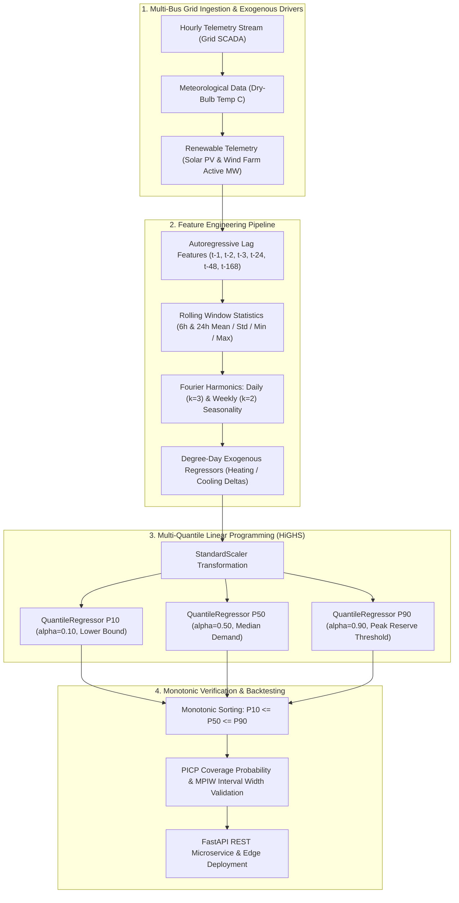

<div align="center">

# ⚡ Smart Grid Probabilistic Energy Forecaster
### Multi-Quantile Pinball Optimization, Fourier Multi-Seasonality & Renewable Grid Load Forecasting

[](https://github.com/yakupakcy36/smart-grid-energy-forecasting/actions/workflows/ci.yml)
[](https://www.python.org/downloads/release/python-3120/)
[](https://opensource.org/licenses/MIT)
[](https://fastapi.tiangolo.com)
[](https://www.docker.com/)

</div>

---

## 📌 Executive Summary

With the rapid integration of intermittent renewables (wind and solar photovoltaics), modern transmission and distribution operators face extreme volatility in **Net Load** ($\text{NetLoad} = \text{Demand} - [\text{Solar} + \text{Wind}]$). Point forecasts (conditional mean) are critically insufficient for spinning reserve planning: dispatching too little reserve risks blackouts ($>\$50,000/\text{MWh}$ value of lost load), while over-dispatching thermal peaker plants creates unnecessary carbon emissions and operational expense.

**`smart-grid-energy-forecasting`** is a production-grade probabilistic time-series forecasting service. By formulating asymmetric linear programming quantile regressions (HiGHS solver), it simultaneously estimates **P10 (optimistic low)**, **P50 (median baseline)**, and **P90 (peak reserve requirement)**, capturing both daily and weekly Fourier harmonics, autoregressive lag dynamics, and temperature degree-day effects without expensive cloud or external API dependencies.

---

## 🏗️ Architecture & Pipeline Overview



---

## 🔬 Mathematical Formulation

### 1. Pinball Quantile Loss (Check Function)
For a specified quantile $\tau \in (0, 1)$, the pinball loss $\rho_\tau(u)$ penalizes positive and negative prediction errors asymmetrically:
$$\rho_\tau(y - \hat{y}) = \begin{cases} \tau (y - \hat{y}) & \text{if } y \ge \hat{y} \\ (1 - \tau) (\hat{y} - y) & \text{if } y < \hat{y} \end{cases}$$

The multi-quantile optimization problem minimizes:
$$\min_{\boldsymbol{\beta}_\tau} \frac{1}{N} \sum_{i=1}^{N} \rho_\tau\left(y_i - \mathbf{x}_i^T \boldsymbol{\beta}_\tau\right) + \lambda \|\boldsymbol{\beta}_\tau\|_1$$
solved via the high-performance **HiGHS** simplex interior-point linear programming algorithm.

### 2. Multi-Seasonal Fourier Expansion
Diurnal and weekly intraday cyclicality are modeled parametrically via orthogonal Fourier trigonometric bases:
$$F(t) = \sum_{k=1}^{K_d} \left[\alpha_k \sin\left(\frac{2\pi k t}{24}\right) + \beta_k \cos\left(\frac{2\pi k t}{24}\right)\right] + \sum_{m=1}^{K_w} \left[\gamma_m \sin\left(\frac{2\pi m t}{168}\right) + \delta_m \cos\left(\frac{2\pi m t}{168}\right)\right]$$

### 3. Reliability & Sharpness Metrics
- **Prediction Interval Coverage Probability (PICP)**:
  $$\text{PICP} = \frac{1}{N} \sum_{i=1}^{N} \mathbb{I}\left(P_{10}(i) \le y_i \le P_{90}(i)\right) \times 100\% \quad (\text{Target} \approx 80\%)$$
- **Mean Prediction Interval Width (MPIW)**:
  $$\text{MPIW} = \frac{1}{N} \sum_{i=1}^{N} \left(P_{90}(i) - P_{10}(i)\right)$$

---

## 🚀 Quick Start

### 1. Installation
```bash
git clone https://github.com/yakupakcy36/smart-grid-energy-forecasting.git
cd smart-grid-energy-forecasting

python -m venv .venv
source .venv/bin/activate  # On Windows: .venv\Scripts\activate
pip install -r requirements.txt
```

### 2. Execute Training & Backtesting Benchmark
```bash
python -m src.pipeline --days 60
```

Sample output:
```text
=================================================================
SMART GRID PROBABILISTIC ENERGY FORECASTER: TRAINING & BENCHMARK
=================================================================
[1/4] Simulating 60 days of multi-bus smart grid telemetry...
      Synthesized 1440 hourly timestamps
      Net Load mean: 394.84 MW, min: 17.46 MW, max: 631.44 MW

[2/4] Training Multi-Quantile Regressors (P10, P50, P90) with HiGHS LP...

[3/4] Backtest Performance on 7-Day Out-of-Sample Horizon:
      Median MAE (P50)             : 54.13 MW
      Pinball Loss P10             : 21.85
      Pinball Loss P50             : 27.06
      Pinball Loss P90             : 9.60
      Empirical Coverage [P10-P90] : 79.2% (Nominal target: 80.0%)
      Mean Interval Width (MPIW)   : 189.52 MW

[4/4] Serializing forecaster bundle to: artifacts/smart_grid_forecaster_bundle.joblib
[SUCCESS] Pipeline execution finished.
```

### 3. Run Test Suite
```bash
pytest tests
```

---

## 🌐 Production REST API

Start the FastAPI server:
```bash
uvicorn api.app:app --host 0.0.0.0 --port 8000
```
Interactive docs: `http://localhost:8000/docs`

### Sample Request (`POST /forecast`):
```bash
curl -X POST "http://localhost:8000/forecast" \
     -H "Content-Type: application/json" \
     -d '{
       "horizon_hours": 24,
       "temperature_override_c": 19.5,
       "seed": 42
     }'
```

### Sample Response:
```json
{
  "horizon_hours": 24,
  "quantiles_modeled": ["P10", "P50", "P90"],
  "forecast_points": [
    {
      "step_ahead_hour": 1,
      "p10_mw": 298.42,
      "p50_mw": 384.15,
      "p90_mw": 472.90,
      "uncertainty_spread_mw": 174.48
    }
  ],
  "peak_expected_p50_mw": 492.10,
  "peak_reserve_p90_mw": 588.64,
  "min_expected_p50_mw": 268.30
}
```

---

## 🐳 Docker Containerization

Run standalone using Docker Compose:
```bash
docker-compose up --build -d
```

Verify service health:
```bash
curl http://localhost:8000/health
```

---

## 📊 Repository Layout

```text
├── api/
│   ├── app.py              # FastAPI endpoints & lifespan
│   ├── schemas.py          # Pydantic v2 validation models
│   └── __init__.py
├── src/
│   ├── config.py           # Quantile alphas & lag hyperparameters
│   ├── features.py         # Fourier harmonics & rolling lag extractor
│   ├── generator.py        # Physics-based synthetic power grid generator
│   ├── model.py            # HiGHS linear programming multi-quantile model
│   ├── pipeline.py         # Out-of-sample backtest & training runner
│   └── __init__.py
├── tests/
│   ├── test_api.py         # Endpoint & schema validation tests
│   ├── test_features.py    # Lag & Fourier transform tests
│   ├── test_generator.py   # Boundary & diurnal cycle tests
│   └── test_model.py       # Pinball loss & monotonic sorting tests
├── Dockerfile
├── docker-compose.yml
├── requirements.txt
├── pytest.ini
└── README.md
```

---

## 📄 License
This project is open-source under the [MIT License](LICENSE).
